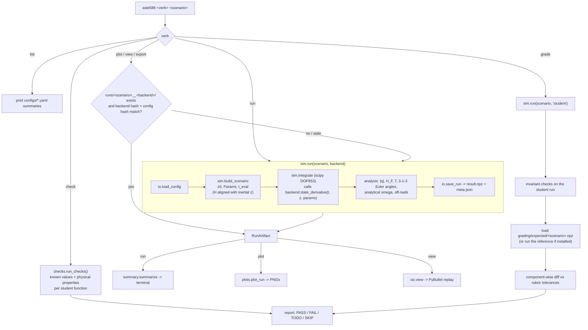

# Control flow of one `aste586` command

Every verb resolves a scenario by name, makes sure an up-to-date run exists,
then does one thing with it.

The student backend is called from exactly one place: the integrator's
right-hand side inside `sim.run`. Nothing else in the harness imports
`aste586.dynamics` except `aste586 check`, which calls the functions directly
with fixed inputs.
